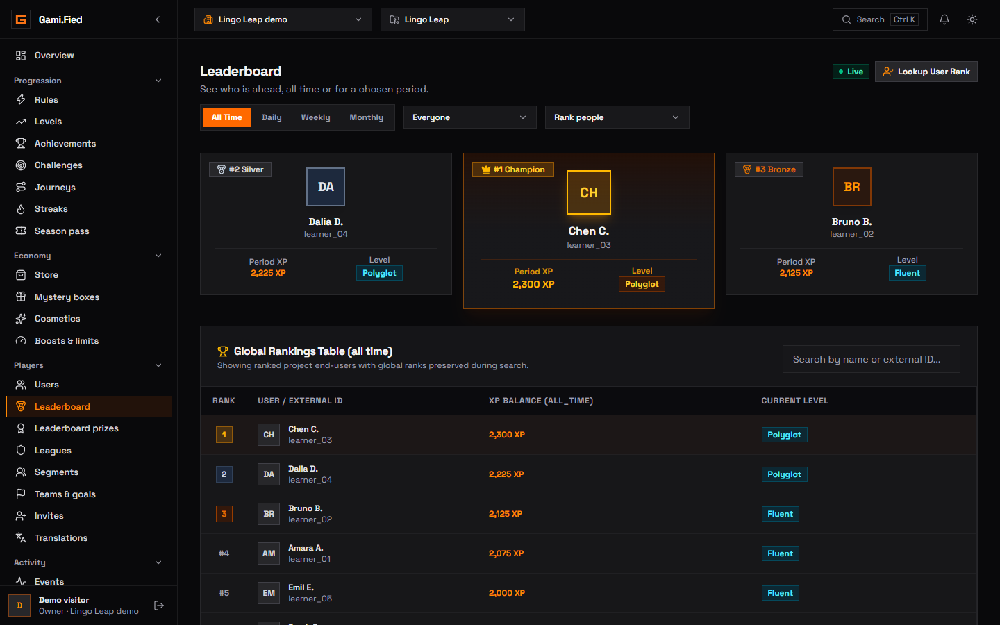
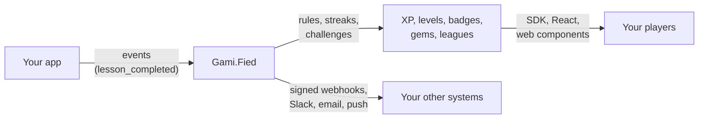
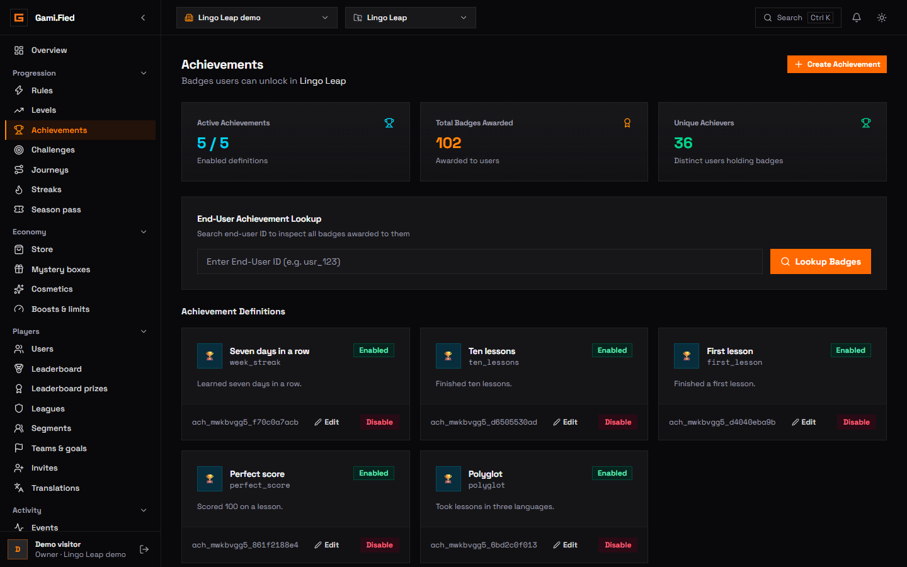
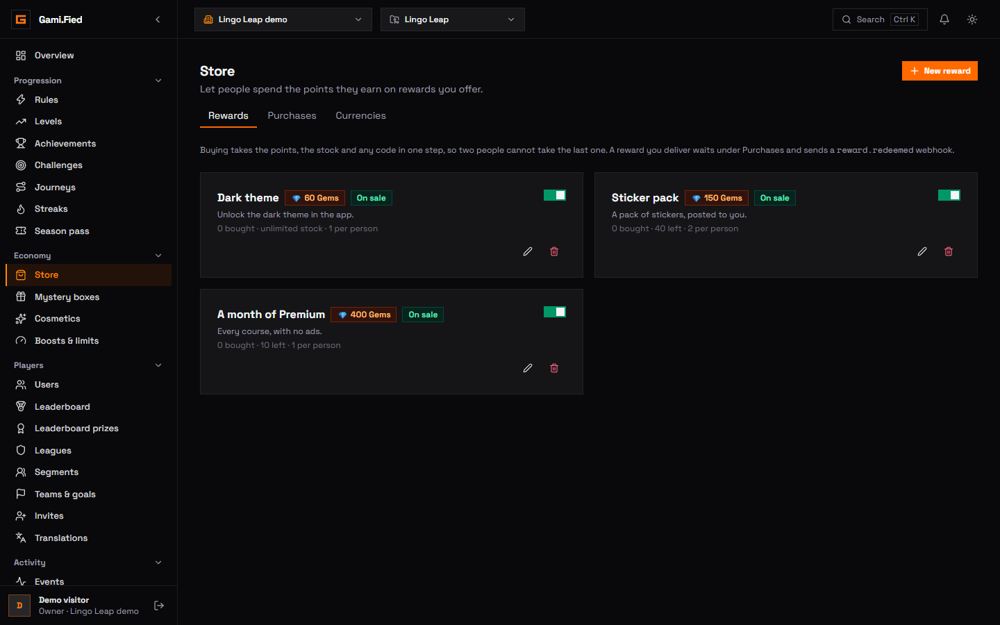
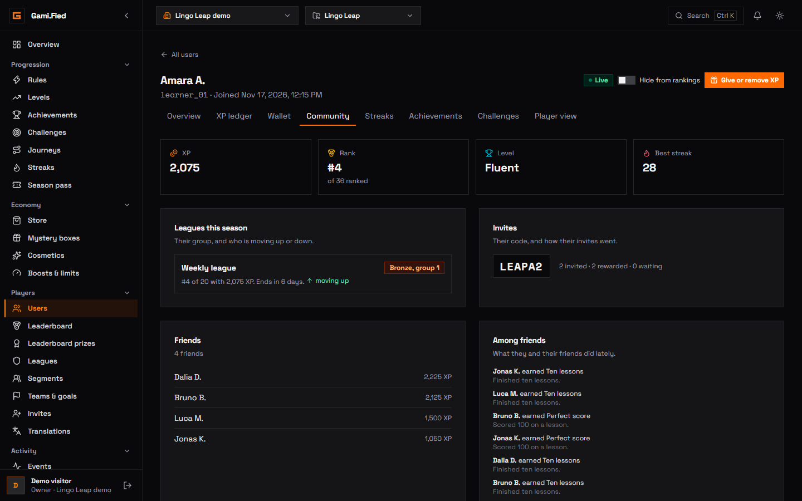
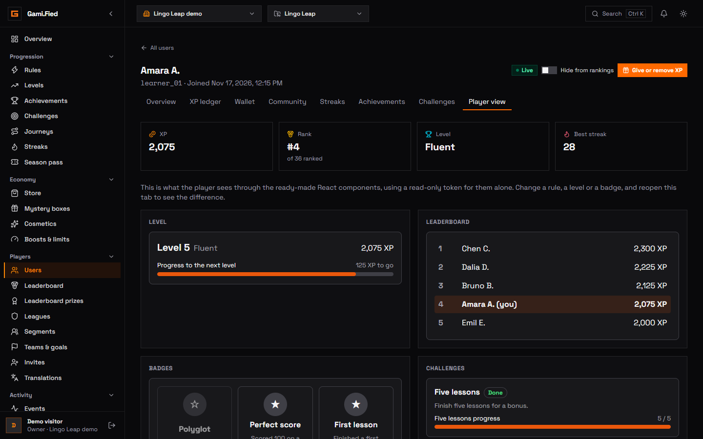
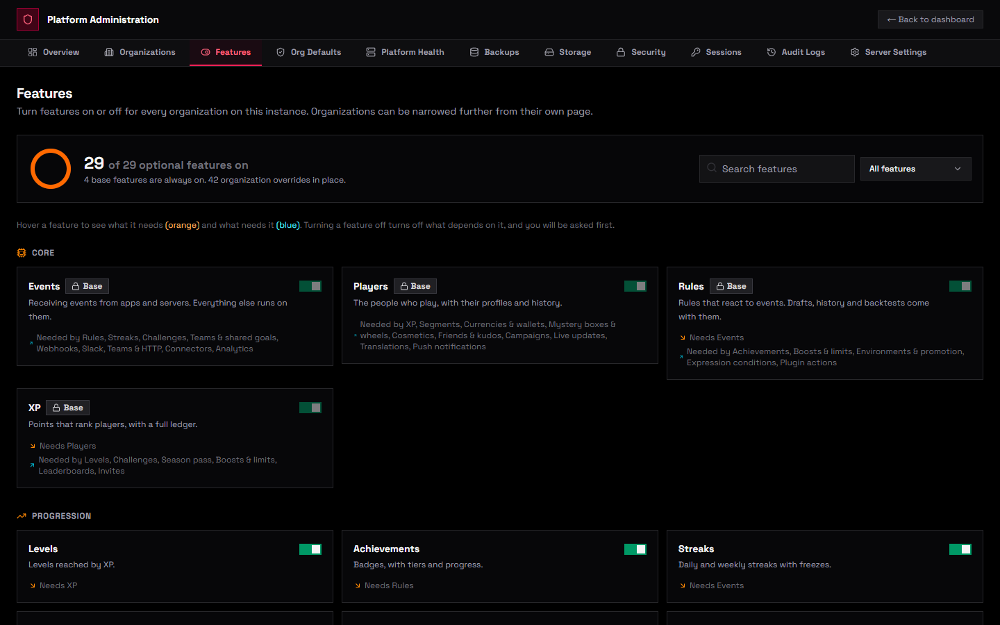

<div align="center">


# Gami.Fied

**The self-hosted, open-source gamification engine.**

Add XP, levels, streaks, badges, leaderboards and rewards to any app,<br>
and keep your players' data on your own server.

[](https://github.com/gami-fied/gami.fied/actions/workflows/ci.yml)
[](https://github.com/gami-fied/gami.fied/releases)
[](LICENSE)
[](https://www.npmjs.com/package/@gami.fied/sdk)

[**Website**](https://gami.fied.cc) · [**Docs**](https://gami.fied.cc/docs/) · [**Playground**](https://gami.fied.cc/playground/) · [**Product tour**](https://gami.fied.cc/#tour) · [**Discussions**](https://github.com/gami-fied/gami.fied/discussions)

<br>



</div>

---

## Why Gami.Fied

- 🏠 **Your data stays yours.** It runs on your servers, next to your app. No player data goes to anyone else.
- 💸 **No per-user pricing.** However many players you have, the only cost is your own hosting.
- 🔓 **Open source.** The server is AGPL-3.0. The SDK, React components and web components are MIT, so they fit in closed-source apps.
- 🐳 **One command to run.** Prebuilt images for amd64 and arm64, and `docker compose up`.

## How it works



Your app sends what happened. Rules you set up in the dashboard decide what it's worth, and the worker pays it out in the background. Your players see their progress through the ready-made components, or your own UI on the API.

---

## Quick start

Prebuilt images are published for `linux/amd64` and `linux/arm64`, so there is nothing to build.

```bash
curl -LO https://github.com/gami-fied/gami.fied/releases/latest/download/docker-compose.yml
curl -LO https://github.com/gami-fied/gami.fied/releases/latest/download/env.example
cp env.example .env
```

Fill in the secrets in `.env`, then run `docker compose up -d`. The dashboard is at `http://localhost:3000`.

The ports are published on `127.0.0.1` only. To reach the dashboard from another machine, put it behind a [reverse proxy with TLS](./docs/install/reverse-proxy.md), or set `BIND_ADDRESS=0.0.0.0` in `.env` for a private network. See [Install with Docker Compose](./docs/install/docker-compose.md), the [production checklist](./docs/install/production-checklist.md) and [Upgrading](./docs/install/upgrading.md).

---

## Use it from your app

**From your server**, send events and read progress:

```bash
npm install @gami.fied/sdk
```

```typescript
import { Gami } from '@gami.fied/sdk';

const gami = new Gami({ baseUrl: 'http://localhost:3001', apiKey: 'gami_live_your_project_api_key' });

// Send what happened. Rules, streaks and challenges run in the background.
await gami.events.track({ userId: 'user_123', type: 'lesson_completed', properties: { score: 100 } });

// Read the player's progress. This needs a key with the levels:read scope.
const progress = await gami.levels.getUserProgress({ userId: 'user_123' });
console.log(`Level ${progress.level.number}, ${progress.totalXp} XP`);
```

**In the player's browser**, never use an API key. Your server makes a short-lived token for one player, and the page uses that:

```typescript
// On your server
const { token } = await gami.endUserTokens.create({ userId: 'user_123' });
```

A token only reads unless you ask for `access: 'write'`, which a player needs to buy a reward, open a box or add a friend.

<table>
<tr>
<th>With React</th>
<th>Without React</th>
</tr>
<tr>
<td>

```tsx
import { GamiProvider, LevelProgress, Leaderboard, ToastHost } from '@gami.fied/react';
import '@gami.fied/react/styles.css';

<GamiProvider endUserToken={token} baseUrl="https://gami.example.com">
  <LevelProgress />
  <Leaderboard period="weekly" />
  <ToastHost />
</GamiProvider>;
```

</td>
<td>

```html
<script src="https://unpkg.com/@gami.fied/elements/dist/gami-elements.js"></script>
<script>
  GamiElements.configure({ baseUrl: 'https://gami.example.com', token });
</script>

<gami-level-progress></gami-level-progress>
<gami-leaderboard period="weekly"></gami-leaderboard>
```

</td>
</tr>
</table>

See the [SDK guide](./docs/sdk.md), [React components](./docs/react.md) and [web components](./docs/web-components.md), or every component live in the [component gallery](https://gami.fied.cc/components/).

---

## What it does

| | Area | What you get |
| :---: | :--- | :--- |
| ⚡ | **Rules** | Turn events into XP, badges and currency, with conditions, totals over time, drafts, a test against past events, and a trace of why a rule fired. |
| 📈 | **[Progression](https://gami.fied.cc/features/progression/)** | Levels, achievements with tiers, daily and weekly streaks with freezes, challenges with steps, journeys that chain them, and a season pass. |
| 🪙 | **[Economy](https://gami.fied.cc/features/economy/)** | Currencies and wallets with expiry, a reward store with stock and codes, mystery boxes with published odds, cosmetics, and boosts and limits against farming. |
| 🏆 | **[Competition](https://gami.fied.cc/features/competition/)** | Leaderboards by day, week and month with prizes for the top places, boards for segments, and leagues with promotion and relegation. |
| 🤝 | **[Community](https://gami.fied.cc/features/community/)** | Teams and shared goals, friends, kudos, an activity feed, share cards and invite codes. |
| 🔔 | **Reaching players** | An in-app inbox, email, push for iPhone, Android and browsers, live updates, and translations into each player's language. |
| 🧩 | **[Integrations](https://gami.fied.cc/features/integrations/)** | A stable `/v1` API, a TypeScript SDK, React and web components, signed webhooks, Slack, Teams and Discord, and connectors for Segment, RudderStack, Stripe and GitHub. |
| 🛡️ | **[Administration](https://gami.fied.cc/features/administration/)** | Roles, audit logs, staging that promotes to production, feature controls per organization, scoped API keys, backups, export and import, and erasure for privacy requests. |

Where it is weaker than the alternatives is on the [comparison page](https://gami.fied.cc/compare/).

<details>
<summary><strong>📸 See the dashboard</strong></summary>
<br>

| Progression | Economy |
| :---: | :---: |
|  |  |
| **Competition** | **Community** |
|  |  |
| **Integrations** | **Administration** |
|  |  |

</details>

---

## Documentation

Everything is at [gami.fied.cc/docs](https://gami.fied.cc/docs/), with search, and in the [`docs/`](./docs) folder.

| 🚀 Start | 🛠️ Build | 🐳 Run |
| :--- | :--- | :--- |
| [Getting started](./docs/getting-started.md) | [Gamification mechanics](./docs/gamification-mechanics.md) | [Deployment and production](./docs/deployment-and-production.md) |
| [Install with Docker](./docs/install/docker-compose.md) | [Economy and store](./docs/economy-and-store.md) | [Platform administration](./docs/platform-administration.md) |
| [Quick starts](./docs/quickstarts/rest.md): REST, Node.js, Python, Next.js, React | [Boxes, passes, teams and journeys](./docs/boxes-passes-teams-and-journeys.md) | [Backups](./docs/backups.md) and [upgrading](./docs/install/upgrading.md) |
| [API reference](./docs/api-reference.md) | [Notifications and webhooks](./docs/notifications-and-integrations.md) | [Architecture](./docs/architecture.md) |
| [TypeScript SDK](./docs/sdk.md) | [Translations](./docs/translations.md) | [Security](./docs/authentication-and-security.md) |

What's new is in the [changelog](./CHANGELOG.md).

---

## Contributing

Bug reports, ideas and pull requests are welcome. [CONTRIBUTING.md](./CONTRIBUTING.md) covers setting up, the checks to run and how contributions are licensed. Please follow the [code of conduct](./CODE_OF_CONDUCT.md).

- **Questions and ideas:** [Discussions](https://github.com/gami-fied/gami.fied/discussions)
- **Bugs and feature requests:** [Issues](https://github.com/gami-fied/gami.fied/issues/new/choose)
- **Security problems:** report them privately, as [SECURITY.md](./SECURITY.md) explains.

To work on it locally, you need Node.js 22, pnpm 11 and Docker:

```bash
pnpm install && cp .env.example .env
pnpm infra:up && pnpm db:migrate:dev
pnpm dev
```

<details>
<summary><strong>Project layout</strong></summary>

```text
gami-fied/
├── apps/
│   ├── api/           # Fastify API on port 3001
│   ├── worker/        # Background worker for rules and delivery
│   ├── dashboard/     # Next.js dashboard on port 3000
│   └── website/       # gami.fied.cc: marketing pages, docs and playground
├── packages/
│   ├── sdk/           # TypeScript client, on npm as @gami.fied/sdk (MIT)
│   ├── react/         # React components, on npm as @gami.fied/react (MIT)
│   ├── elements/      # The same components as HTML elements, @gami.fied/elements (MIT)
│   ├── database/      # PostgreSQL schema, Drizzle ORM, migrations and auth
│   ├── rules/         # Rule evaluation
│   ├── rewards/       # XP, badges, wallets and prizes
│   ├── progression/   # Levels and streaks
│   ├── challenges/    # Challenge progress
│   ├── leaderboards/  # Rankings, segments and leagues
│   ├── notifications/ # In-app and email notifications
│   ├── webhooks/      # Webhook delivery and signing
│   ├── integrations/  # Slack, Teams, Discord, HTTP and push
│   ├── queue/         # Shared queue definitions
│   ├── ui/            # Interface pieces shared by the dashboard and the website
│   ├── types/         # Shared TypeScript types
│   └── config/        # Shared configuration
├── deploy/            # One-click deploy files and the status page
└── docs/              # Documentation, also served at gami.fied.cc/docs
```

</details>

---

## License

The server, worker and dashboard are licensed under the **[GNU AGPL v3.0](LICENSE)**. The SDK, the React components and the web components (`packages/sdk`, `packages/react` and `packages/elements`) are licensed under the **[MIT License](packages/sdk/LICENSE)**, so you can use them in closed-source apps.

<div align="center">
<br>

**If Gami.Fied is useful to you, a ⭐ on GitHub helps other people find it.**

</div>
